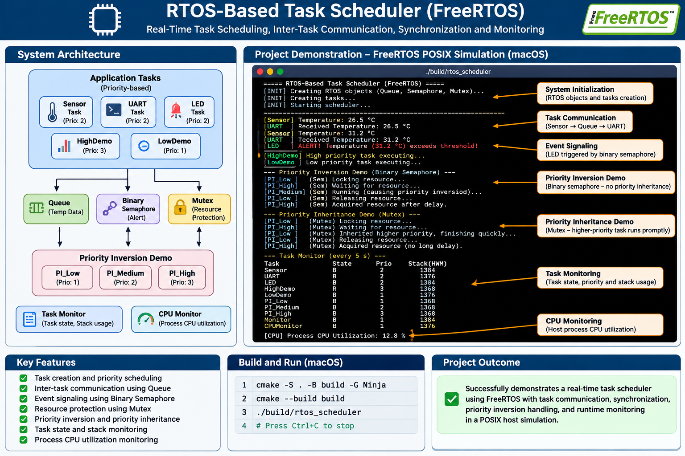

## Project Demonstration

The following infographic illustrates the system architecture, FreeRTOS application tasks, inter-task communication, synchronization mechanisms, priority inversion experiment, and monitoring features.



> **Note:** This project runs as a FreeRTOS POSIX host simulation on macOS. It is not an MCU firmware implementation.

# RTOS-Based Task Scheduler

A real-time task scheduling project using **FreeRTOS**, demonstrating task creation, priority-based preemptive scheduling, inter-task communication, synchronization, priority inversion, and runtime monitoring.

## Project Overview

This project implements a FreeRTOS-based task scheduler using the **GCC POSIX simulator**. It demonstrates fundamental RTOS concepts through multiple application tasks running concurrently.

The project is designed to explore task scheduling, synchronization mechanisms, resource sharing, and runtime monitoring in an RTOS environment.

> **Note:** This is a POSIX host simulation. It is not an MCU-targeted firmware implementation.

## Features

- Task creation and priority assignment
- Preemptive task scheduling
- Inter-task communication using queues
- Binary semaphore-based event signaling
- Mutex-based resource protection
- Priority inversion demonstration
- Priority inheritance demonstration
- Task state monitoring
- Stack high-water-mark monitoring
- Host process CPU utilization monitoring

## System Architecture

```text
                  FreeRTOS Scheduler
                         |
       +-----------------+------------------+
       |                 |                  |
  Sensor Task        UART Task          LED Task
       |                 ^                  ^
       |                 |                  |
       +---- Queue ------+                  |
       |                                    |
       +------ Binary Semaphore ------------+

       +------------------------------------+
       |          Scheduling Demo           |
       |                                    |
       |    High Priority / Low Priority    |
       +------------------------------------+

       +------------------------------------+
       |       Priority Inversion Demo      |
       |                                    |
       |  Low / Medium / High Priority      |
       |  Mutex and Binary Semaphore        |
       +------------------------------------+

       +------------------------------------+
       |           Task Monitor              |
       |  Task State and Stack Monitoring   |
       +------------------------------------+

       +------------------------------------+
       |           CPU Monitor               |
       |       Host Process CPU Usage       |
       +------------------------------------+
```

## Application Tasks

| Task | Responsibility |
|---|---|
| Sensor | Generates simulated temperature readings |
| UART | Receives and displays sensor data |
| LED | Handles temperature alert notifications |
| HighDemo | Demonstrates high-priority task execution |
| LowDemo | Demonstrates low-priority task execution |
| Monitor | Monitors task states and stack usage |
| CPUMonitor | Measures host process CPU utilization |
| PI_Low | Low-priority resource owner |
| PI_Medium | Medium-priority CPU-intensive task |
| PI_High | High-priority resource requester |

## RTOS Concepts Demonstrated

### 1. Task Scheduling

Demonstrates priority-based preemptive scheduling using FreeRTOS tasks.

### 2. Queue Communication

The Sensor task sends temperature data through a FreeRTOS queue. The UART task receives and displays the data.

### 3. Binary Semaphore

A binary semaphore signals the LED task when the temperature reaches the configured alert threshold.

### 4. Mutex and Priority Inheritance

A mutex protects a shared resource and demonstrates FreeRTOS priority inheritance.

### 5. Priority Inversion

Compares two synchronization approaches:

- Binary semaphore without priority inheritance.
- Mutex with priority inheritance.

### 6. Task Monitoring

Uses FreeRTOS APIs:

- `vTaskList()`
- `eTaskGetState()`
- `uxTaskGetStackHighWaterMark()`

### 7. CPU Monitoring

Measures host process CPU utilization using macOS system APIs:

- `getrusage()`
- `clock_gettime()`

The measurement covers the entire simulation process, not individual FreeRTOS tasks.

## Technologies Used

- Language: C
- RTOS: FreeRTOS Kernel
- Port: GCC POSIX
- Build System: CMake
- Build Generator: Ninja
- Compiler: Apple Clang
- Platform: macOS

## Project Structure

```text
RTOS_Task_Scheduler/
|
|-- Application/
|   |-- include/
|   |-- tasks/
|   |-- drivers/
|   |-- main.c
|
|-- Config/
|   |-- FreeRTOSConfig.h
|
|-- FreeRTOS/
|   |-- FreeRTOS-Kernel/
|
|-- Documentation/
|
|-- Tests/
|
|-- CMakeLists.txt
|-- README.md
|-- .gitignore
```

## Build and Run

### Prerequisites

- C compiler
- CMake
- Ninja
- POSIX-compatible operating system

### 1. Clone the repository

```bash
git clone https://github.com/jagadeeshsys/RTOS-based-task-scheduler.git
```

### 2. Enter the project directory

```bash
cd RTOS-based-task-scheduler
```

### 3. Configure the project

```bash
cmake -S . -B build -G Ninja
```

### 4. Build

```bash
cmake --build build
```

### 5. Execute

```bash
./build/rtos_scheduler
```

Press `Ctrl+C` to stop the simulation.

## Testing and Validation

The following behaviors were verified during host simulation:

- Successful task creation and scheduler startup.
- Sensor-to-UART queue communication.
- Temperature alert signaling.
- High-priority task execution.
- Priority inversion without priority inheritance.
- Priority inheritance using a mutex.
- Task state and stack monitoring.
- Host process CPU utilization reporting.

## Limitations

- Uses the FreeRTOS GCC POSIX port.
- Does not run on a physical microcontroller.
- UART and LED operations are simulated using terminal output.
- CPU utilization is measured at process level, not per task.
- Host operating-system scheduling and timing differ from embedded hardware.

## Learning Outcomes

- Understanding FreeRTOS task management.
- Applying priority-based scheduling.
- Implementing queues, semaphores, and mutexes.
- Understanding priority inversion and priority inheritance.
- Monitoring task states and stack usage.
- Measuring CPU utilization in a host simulation.

## Author

**Jagadeesh**

GitHub: [@jagadeeshsys](https://github.com/jagadeeshsys)

## License

Refer to the FreeRTOS Kernel license included in the `FreeRTOS/FreeRTOS-Kernel` directory for the kernel's licensing terms.
---

